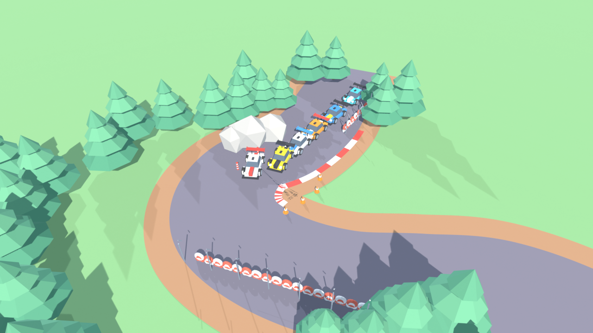

# Blender MCP - Stylized Low-Poly Race Track

A specialized Blender toolkit and AI Skill for generating high-quality stylized low-poly isometric racing environments using Blender Python (`bpy`).



## Overview

This repository provides an autonomous AI Skill and procedural Blender generation framework capable of creating publication-ready, stylized low-poly racing scenes from a single prompt.

### Features
- **Fluid Spline Racetracks**: Parametric Catmull-Rom road generation with asphalt, gravel shoulders, dashed markings, and alternating red/white apex curbs.
- **Detailed GT Race Cars**: Scaled vehicles (~3.0m x 1.6m) featuring aerodynamic wedge silhouettes, tinted glass canopies, splitters, swan-neck GT rear wings, diffusers, custom liveries, and multi-spoke wheels with colored brake calipers.
- **Circuit Environment**: Dense alpine pine forests, faceted limestone apex boulders, double-row tire barriers, and chain-link fences with angled safety overhangs.
- **Optimized Lighting & Camera**: Full-bleed diagonal isometric camera framing with warm sun key lighting and cool fill bounce.

---

## Directory Structure

```
blender_mcp/
├── README.md
├── race_track_preview.png
├── race_track_scene.blend
└── skills/
    └── lowpoly-race-track-generator/
        ├── SKILL.md                 # Complete AI Skill & Directives
        └── template_race_scene.py   # Standalone procedural Blender script
```

---

## Quickstart

Run headless in Blender to generate the complete `.blend` file:

```bash
blender --background --python skills/lowpoly-race-track-generator/template_race_scene.py
```

Or open `race_track_scene.blend` directly in Blender.

---

## AI Skill Directives

Refer to [`skills/lowpoly-race-track-generator/SKILL.md`](./skills/lowpoly-race-track-generator/SKILL.md) for the rules, mathematical formulations, and best practices to feed into LLMs / AI agents.
